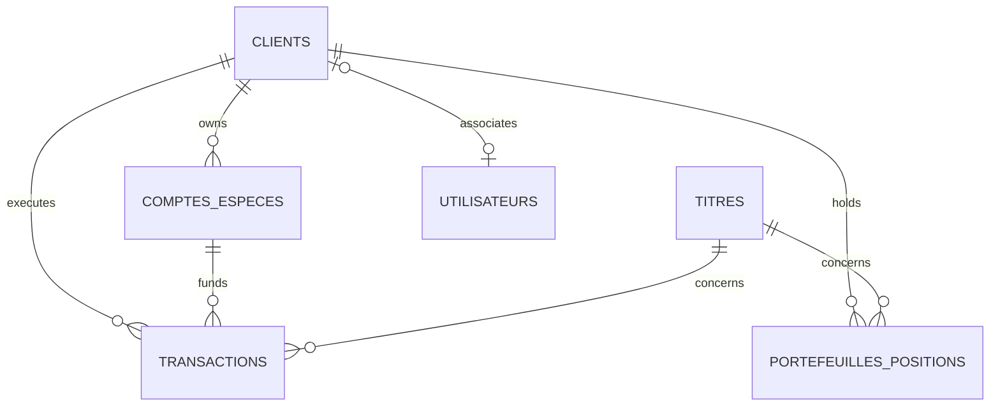

# Advanced SQL Project — Brokerage Platform & Financial Markets

> **Course:** Advanced SQL · Ycode A2627_4728 · Bachelor 2 (2026-2027)  
> **Instructor:** Luc Charlopeau  
> **Deliverables:** `projet.sql` and `README.md`  
> **Live Deployment:** https://projetsqlfinance.vercel.app/

Financial brokerage and trading platform for CAD-quoted securities, managing client cash accounts, stock portfolios, and automated buy/sell order execution under strict integrity controls.

---

## 1. Schema and Tables

The relational model includes 6 interconnected business tables:
* `clients`: Investor identities and unique contact information.
* `comptes_especes`: Liquid cash balances (in CAD) with a `solde >= 0` check constraint.
* `titres`: Traded financial instruments with unique ticker symbols, sectors, and current market prices.
* `portefeuilles_positions`: Quantities held and weighted average purchase price (WAPP / PMP) per client/ticker pair.
* `transactions`: Immutable transaction ledger for executed orders (ACHAT / VENTE) with volume and unit price (> 20,000 rows).
* `utilisateurs`: Application user profile linked to authentication (Supabase / Postgres).



---

## 2. Stored Procedure: `executer_ordre`

* **What it does:** Receives an order request (client, cash account, security, order type `ACHAT`/`VENTE`, quantity), validates inputs and current market price, and securely inserts the corresponding transaction.
* **Why it exists:** It centralizes and encapsulates order execution business logic. Defined with `SECURITY DEFINER`, it allows traders/brokers to execute orders without granting them direct write privileges on underlying financial tables.
* **Proof:**
  ```sql
  CALL public.executer_ordre(1, 1, 1, 'ACHAT', 5, NULL);
  ```
  *Observed Result:* The order is inserted using the official active market price (`RY.TO`), returns the newly created transaction ID, and automatically triggers the portfolio and cash balance updates.

---

## 3. Business Trigger: `controler_et_appliquer_ordre`

* **What it does:** Runs `BEFORE INSERT` on the `transactions` table. It ensures the cash account belongs to the client, validates currency matching, rejects purchases if the cash balance is insufficient, and rejects sales if the held stock quantity is insufficient. Upon validation, it atomically updates the cash balance and recalculates the weighted average purchase price for portfolio positions.
* **Why it resides in the database rather than the application:** To ensure absolute financial integrity and prevent race conditions. Even in the event of an application bug or direct unauthorized manual `INSERT`, the database engine strictly prevents negative balances (overdrafts) and unauthorized naked short selling.
* **Proof:**
  * *Test 1 (Rejected due to insufficient funds):*
    ```sql
    INSERT INTO public.transactions (client_id, compte_id, titre_id, type, quantite, prix_unitaire)
    VALUES (1, 1, 1, 'ACHAT', 9999999, 160.00);
    ```
    *Observed Result:* `ERROR: Solde insuffisant : 85305.00, montant requis : 1599999840.00. (SQLSTATE 23514)`
  * *Test 2 (Rejected due to unauthorized short selling):*
    ```sql
    INSERT INTO public.transactions (client_id, compte_id, titre_id, type, quantite, prix_unitaire)
    VALUES (1, 1, 11, 'VENTE', 50000, 140.00);
    ```
    *Observed Result:* `ERROR: Quantite detenue insuffisante pour vendre le titre 11. (SQLSTATE 23514)`

---

## 4. Abstraction Views: `vue_courtier_marche` & `vue_audit_transactions`

* **What they do:**
  * `vue_courtier_marche`: Displays the securities catalog with active prices, total shareholder count, and circulating shares.
  * `vue_audit_transactions`: Aggregates the full transaction history for compliance (client full name, account, security, order type, and computed total CAD amount).
* **Why they exist:** They enforce abstraction and isolation. Brokers cannot inspect client cash balances or private contact data, while compliance auditors receive a consolidated, analytics-ready read-only view without direct access to core tables.
* **Proof:**
  * *Market Consultation (Broker/Trader):*
    ```sql
    SELECT symbole, nom_titre, cours_actuel, total_actions_en_circulation 
    FROM public.vue_courtier_marche LIMIT 3;
    ```
    *Observed Result:* Quotation data instantly accessible without exposing sensitive personal or banking data.
  * *Audit Consultation (Auditor):*
    ```sql
    SELECT client_nom_complet, symbole, type_ordre, montant_total 
    FROM public.vue_audit_transactions LIMIT 3;
    ```
    *Observed Result:* Consolidated view displaying transactions and calculated totals.

---

## 5. DCL, Roles and Privileges

* **What it does:** Defines two isolated business roles (`courtier_trader` with user `trader_alex`, and `auditeur_conformite` with user `auditeur_claire`). All direct table privileges have been revoked on the public schema. Each profile has access only to its dedicated view or authorized procedure.
* **Why it exists:** Adheres to the principle of least privilege. Under no circumstances should an auditor be able to modify or delete financial records, and a broker should never be able to view another client's bank balances.
* **Proof:**
  * **For the `courtier_trader` role (`trader_alex`):**
    * *Authorized action:*
      ```sql
      SET ROLE trader_alex;
      SELECT count(*) FROM public.vue_courtier_marche;
      ```
      *Observed Result:* `count = 20` (Success).
    * *Denied action:*
      ```sql
      SET ROLE trader_alex;
      SELECT * FROM public.comptes_especes;
      ```
      *Observed Result:* `ERROR: permission denied for table comptes_especes`.
  * **For the `auditeur_conformite` role (`auditeur_claire`):**
    * *Authorized action:*
      ```sql
      SET ROLE auditeur_claire;
      SELECT count(*) FROM public.vue_audit_transactions;
      ```
      *Observed Result:* `count = 20000` (Success).
    * *Denied action:*
      ```sql
      SET ROLE auditeur_claire;
      DELETE FROM public.transactions WHERE transaction_id = 1;
      ```
      *Observed Result:* `ERROR: permission denied for table transactions`.

---

## 6. Indexes and Performance Justification

The `transactions` table contains **20,000 rows**. Two indexes target high-volume use cases:
1. `idx_transactions_client_date` on `(client_id, date_transaction DESC)`: Client account statements sorted by date.
2. `idx_transactions_titre_date` on `(titre_id, date_transaction)`: Volume aggregation and analysis per financial asset.

* **Why they exist:** Avoid full sequential scans (*Seq Scan*) across tens of thousands of rows during frequent frontend queries.
* **Proof (real measurements using `EXPLAIN ANALYZE`):**

### Index 1: Client Transaction Statement
```sql
EXPLAIN (ANALYZE, BUFFERS)
SELECT transaction_id, titre_id, type, quantite, prix_unitaire, date_transaction
FROM public.transactions
WHERE client_id = 42 AND date_transaction >= '2025-01-01'
ORDER BY date_transaction DESC;
```
* **Before index (Seq Scan):** `Execution Time: 2.023 ms` (full scan of 20,000 rows, 226 blocks read)
* **After index (Index Scan):** `Execution Time: 0.067 ms` (3 blocks read)
* **Performance Gain:** Query is **~30x faster**!

### Index 2: Asset Volume Analysis
```sql
EXPLAIN (ANALYZE, BUFFERS)
SELECT type, sum(quantite) as total_volume, round(avg(prix_unitaire), 2) as prix_moyen
FROM public.transactions
WHERE titre_id = 11 AND date_transaction >= '2025-01-01'
GROUP BY type;
```
* **Before index (Seq Scan):** `Execution Time: 1.808 ms` (full scan of 20,000 rows)
* **After index (Index Scan):** `Execution Time: 0.075 ms`
* **Performance Gain:** Query is **~24x faster**!

---

## 7. Project Execution

The [projet.sql](./projet.sql) file contains the full code and runs error-free on an empty database:
```bash
psql -U postgres -d projet -f projet.sql
```
