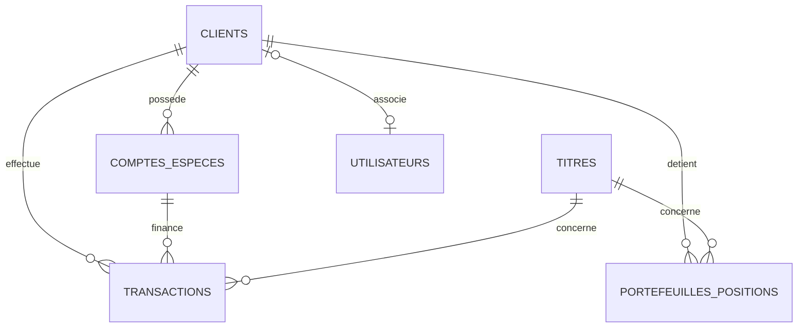

# Projet SQL Avancé — Plateforme de Courtage & Marchés Financiers

> **Matière :** SQL avancé · Ycode A2627_4728 · Bachelor 2 (2026-2027)  
> **Formateur :** Luc Charlopeau  
> **Livrables :** `projet.sql` et `README.md`  
> **Déploiement :** https://projetsqlfinance.vercel.app/

Plateforme de courtage financier et de négociation de titres cotés en CAD, gérant les comptes d'espèces des clients, leurs portefeuilles d'actions et l'exécution automatisée des ordres d'achat et de vente avec contrôle d'intégrité strict.

---

## 1. Schéma et Tables

Le modèle relationnel comprend 6 tables métier reliées entre elles :
* `clients` : Identité et coordonnées uniques des investisseurs.
* `comptes_especes` : Soldes liquides (en devise CAD) avec contrainte `solde >= 0`.
* `titres` : Instruments négociables cotés avec symbole unique, secteur et cours actuel.
* `portefeuilles_positions` : Quantité détenue et prix moyen d'achat (PMP) par paire client/titre.
* `transactions` : Journal immuable des ordres exécutés (ACHAT / VENTE) avec volume et prix unitaire (> 20 000 lignes).
* `utilisateurs` : Profil applicatif lié à l'authentification (Supabase / Postgres).



---

## 2. Procédure Stockée : `executer_ordre`

* **Ce qu'elle fait :** Reçoit la demande d'un ordre (client, compte espèces, titre, type `ACHAT`/`VENTE`, quantité), vérifie la validité des paramètres et le cours actuel du titre, puis déclenche l'insertion sécurisée de la transaction correspondante.
* **Pourquoi elle est là :** Elle centralise et encapsule la logique de passage d'ordre. Définie en `SECURITY DEFINER`, elle permet aux courtiers de passer des ordres sans leur accorder de droits directs en écriture sur les tables financières sous-jacentes.
* **La preuve :**
  ```sql
  CALL public.executer_ordre(1, 1, 1, 'ACHAT', 5, NULL);
  ```
  *Résultat observé :* L'ordre est inséré avec le cours officiel en vigueur (`RY.TO`), retourne l'identifiant de la nouvelle transaction, et déclenche automatiquement la mise à jour du portefeuille et du compte espèces.

---

## 3. Trigger Métier : `controler_et_appliquer_ordre`

* **Ce qu'il fait :** Se déclenche `BEFORE INSERT` sur la table `transactions`. Il vérifie que le compte appartient au client, que les devises concordent, bloque les achats si le solde espèces est insuffisant, et bloque les ventes si la quantité d'actions détenue est insuffisante. Lors de la validation, il met à jour atomiquement le solde du compte et recalcule le prix moyen d'achat dans les positions.
* **Pourquoi il est là dans la base plutôt que dans l'application :** Pour garantir l'intégrité financière absolue et éliminer tout risque de concurrence (*race condition*). Même en cas de bugs dans l'application ou de tentative d'insertion directe illégitime (`INSERT` manuel), la base de données interdit physiquement tout découvert bancaire ou vente d'actions non possédées.
* **La preuve :**
  * *Test 1 (Rejet pour solde insuffisant) :*
    ```sql
    INSERT INTO public.transactions (client_id, compte_id, titre_id, type, quantite, prix_unitaire)
    VALUES (1, 1, 1, 'ACHAT', 9999999, 160.00);
    ```
    *Résultat observé :* `ERROR: Solde insuffisant : 85305.00, montant requis : 1599999840.00. (SQLSTATE 23514)`
  * *Test 2 (Rejet pour vente à découvert non autorisée) :*
    ```sql
    INSERT INTO public.transactions (client_id, compte_id, titre_id, type, quantite, prix_unitaire)
    VALUES (1, 1, 11, 'VENTE', 50000, 140.00);
    ```
    *Résultat observé :* `ERROR: Quantite detenue insuffisante pour vendre le titre 11. (SQLSTATE 23514)`

---

## 4. Vues d'Abstraction : `vue_courtier_marche` & `vue_audit_transactions`

* **Ce qu'elles font :**
  * `vue_courtier_marche` : Présente le catalogue des titres avec leur cours actuel, le nombre total d'actionnaires et le volume en circulation.
  * `vue_audit_transactions` : Agrège pour la conformité l'historique complet (nom du client, compte, titre, type d'ordre et montant total calculé en CAD).
* **Pourquoi elles sont là :** Elles appliquent le principe d'abstraction et d'isolation. Les courtiers n'ont pas accès aux soldes ni aux coordonnées personnelles des clients, et les auditeurs disposent d'une vue consolidée prête à l'analyse sans accès direct aux tables primaires.
* **La preuve :**
  * *Consultation marché (Courtier) :*
    ```sql
    SELECT symbole, nom_titre, cours_actuel, total_actions_en_circulation 
    FROM public.vue_courtier_marche LIMIT 3;
    ```
    *Résultat observé :* Données de cotation accessibles immédiatement, sans aucune fuite de données personnelles ou bancaires.
  * *Consultation audit (Auditeur) :*
    ```sql
    SELECT client_nom_complet, symbole, type_ordre, montant_total 
    FROM public.vue_audit_transactions LIMIT 3;
    ```
    *Résultat observé :* Vue consolidée affichant les transactions et montants calculés.

---

## 5. DCL, Rôles et Privilèges

* **Ce qu'il fait :** Définit deux rôles métiers étanches (`courtier_trader` avec l'utilisateur `trader_alex`, et `auditeur_conformite` avec l'utilisateur `auditeur_claire`). Tous les privilèges directs sur les tables ont été révoqués sur le schéma public. Chaque profil n'a accès qu'à sa vue dédiée ou à la procédure autorisée.
* **Pourquoi il est là :** Respecte le principe du moindre privilège. Un auditeur ne doit sous aucun prétexte pouvoir modifier ou supprimer une transaction financière, et un courtier ne doit pas pouvoir lire les soldes bancaires des autres clients.
* **La preuve :**
  * **Pour le rôle `courtier_trader` (`trader_alex`) :**
    * *Action autorisée :*
      ```sql
      SET ROLE trader_alex;
      SELECT count(*) FROM public.vue_courtier_marche;
      ```
      *Résultat observé :* `count = 20` (Succès).
    * *Action refusée :*
      ```sql
      SET ROLE trader_alex;
      SELECT * FROM public.comptes_especes;
      ```
      *Résultat observé :* `ERROR: permission denied for table comptes_especes`.
  * **Pour le rôle `auditeur_conformite` (`auditeur_claire`) :**
    * *Action autorisée :*
      ```sql
      SET ROLE auditeur_claire;
      SELECT count(*) FROM public.vue_audit_transactions;
      ```
      *Résultat observé :* `count = 20000` (Succès).
    * *Action refusée :*
      ```sql
      SET ROLE auditeur_claire;
      DELETE FROM public.transactions WHERE transaction_id = 1;
      ```
      *Résultat observé :* `ERROR: permission denied for table transactions`.

---

## 6. Index et Justification de Performance

La table `transactions` contient **20 000 lignes**. Deux index ciblent les cas d'usage à fort volume :
1. `idx_transactions_client_date` sur `(client_id, date_transaction DESC)` : Relevé de compte client par date.
2. `idx_transactions_titre_date` sur `(titre_id, date_transaction)` : Analyse et agrégation des volumes par titre financier.

* **Pourquoi ils sont là :** Évitent le parcours séquentiel intégral (*Seq Scan*) des dizaines de milliers d'enregistrements lors des recherches fréquentes de l'application.
* **La preuve (mesures réelles avec `EXPLAIN ANALYZE`) :**

### Index 1 : Relevé des transactions d'un client
```sql
EXPLAIN (ANALYZE, BUFFERS)
SELECT transaction_id, titre_id, type, quantite, prix_unitaire, date_transaction
FROM public.transactions
WHERE client_id = 42 AND date_transaction >= '2025-01-01'
ORDER BY date_transaction DESC;
```
* **Avant index (Seq Scan) :** `Execution Time: 2.023 ms` (parcours de 20 000 lignes, 226 blocs lus)
* **Après index (Index Scan) :** `Execution Time: 0.067 ms` (3 blocs lus)
* **Gain :** Requête **~30 fois plus rapide** !

### Index 2 : Analyse des volumes par actif financier
```sql
EXPLAIN (ANALYZE, BUFFERS)
SELECT type, sum(quantite) as total_volume, round(avg(prix_unitaire), 2) as prix_moyen
FROM public.transactions
WHERE titre_id = 11 AND date_transaction >= '2025-01-01'
GROUP BY type;
```
* **Avant index (Seq Scan) :** `Execution Time: 1.808 ms` (parcours de 20 000 lignes)
* **Après index (Index Scan) :** `Execution Time: 0.075 ms`
* **Gain :** Requête **~24 fois plus rapide** !

---

## 7. Exécution du Projet

Le fichier [projet.sql](./projet.sql) réunit l'intégralité du code et s'exécute sans erreur sur une base vide :
```bash
psql -U postgres -d projet -f projet.sql
```