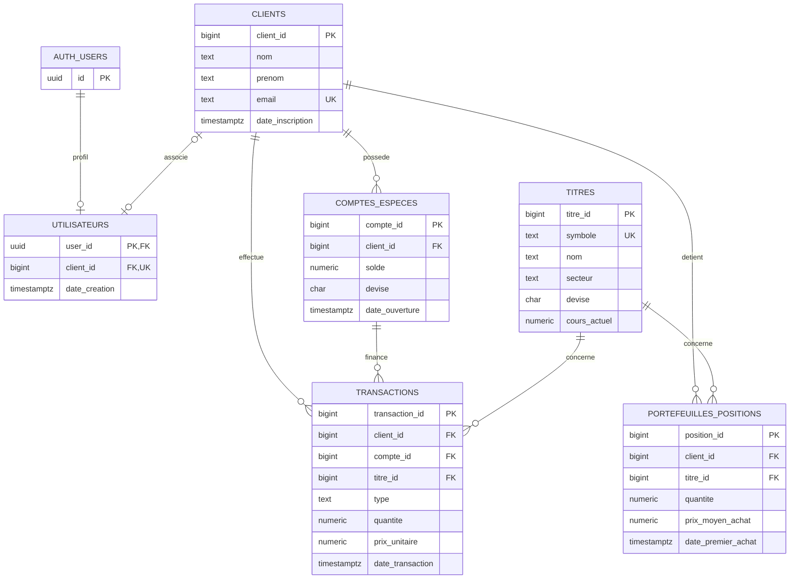

# Projet SQL finance

## Schéma de données (membre 1)

Le script [sql/01_schema.sql](./sql/01_schema.sql) crée les tables métier de la
plateforme et leurs clés, contraintes et relations. Il doit être exécuté dans
l’éditeur SQL de Supabase, où le schéma `auth` est fourni.

### Diagramme relationnel

`AUTH_USERS` représente `auth.users`, gérée par Supabase et non créée dans le
schéma `public`. Les mots de passe n'apparaissent donc pas dans le modèle
applicatif : Supabase Auth prend en charge les identifiants et leur stockage
sécurisé. `public.utilisateurs` est le profil applicatif associé au compte
Auth. Après la création du compte dans Supabase Auth, son UUID peut être lié à
une ligne de `public.utilisateurs`. La colonne `client_id` est facultative et
unique : un profil peut être associé à zéro ou un client, et un client à zéro
ou un profil. RLS autorise un utilisateur authentifié à lire uniquement son
propre profil.

### Description des tables et des relations

| Table | Rôle et relations |
|---|---|
| `clients` | Identité métier du client. Un email ne peut apparaître qu'une fois. Un client peut avoir plusieurs comptes, positions et transactions. |
| `utilisateurs` | Profil relié à `auth.users` par `user_id`. `client_id` associe facultativement le profil à un client et est unique. |
| `comptes_especes` | Compte de liquidités appartenant à un client. Le solde ne peut pas être négatif et la devise doit avoir trois lettres majuscules. |
| `titres` | Instrument négociable identifié par un symbole unique; conserve son secteur, sa devise et son cours actuel. |
| `portefeuilles_positions` | Quantité d'un titre détenue par un client et prix moyen d'achat. Une seule position par paire client/titre; la quantité doit être positive. |
| `transactions` | Historique des achats et ventes d'un titre, rattaché au client, à son compte espèces et au titre concerné. Le type est limité à `ACHAT` ou `VENTE`; quantité et prix unitaire doivent être positifs. |

La clé étrangère composée `(compte_id, client_id)` de `transactions` garantit
que le compte utilisé appartient bien au client indiqué sur la transaction.
Les suppressions de clients, comptes et titres référencés sont restreintes afin
de préserver la cohérence de l'historique. Les positions et les transactions
sont reliées aux titres par `titre_id`.

Le script couvre uniquement le schéma. Les données sont générées par
`sql/02_donnees.sql`. Le membre 3 ajoute `sql/03_procedure_trigger.sql`, qui
crée la procédure `public.executer_ordre` et le trigger de contrôle des
insertions dans `public.transactions`. Il faut exécuter les scripts dans
l’ordre `01_schema.sql`, `02_donnees.sql`, puis `03_procedure_trigger.sql`.

La procédure accepte le client, le compte espèces, le titre, le type (`ACHAT`
ou `VENTE`) et la quantité. Le trigger utilise le cours actuel du titre,
contrôle le compte et la devise, vérifie les fonds ou la position disponible,
puis met à jour le solde espèces et la position dans la même transaction que
l’ordre. Il protège également les écritures directes dans `transactions`.

Pour vérifier ces comportements après l’installation, exécuter
`sql/04_tests_integrite.sql`. Le script teste les achats, le calcul du prix
moyen, une vente partielle, le contrôle des insertions directes et plusieurs
rejets d’intégrité. Il annule ses données de test à la fin.

Les vues, les rôles, les index et leurs mesures de performance restent à
ajouter par les membres responsables de ces parties.